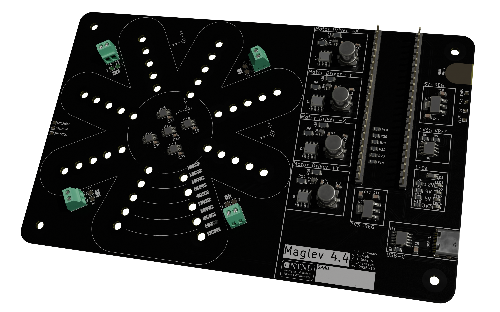
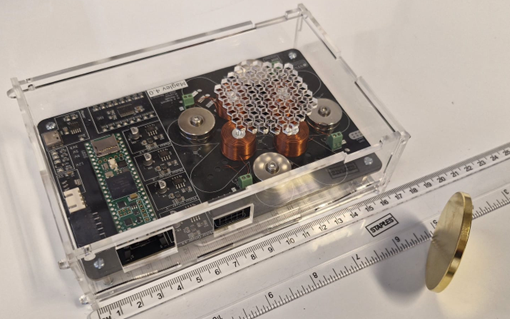
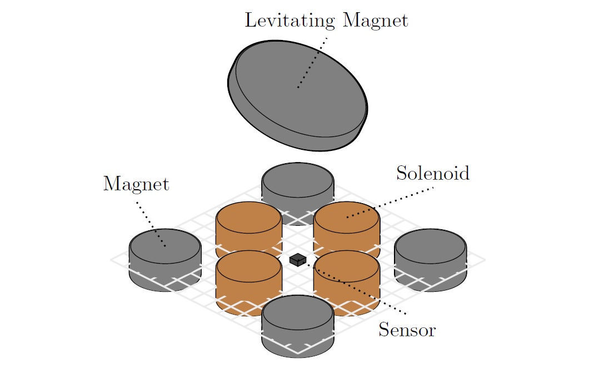

<h1 align="center">Welcome to Maggy 🧲</h1>

<strong>A small lab for students in control engineering to learn control topics at home!</strong>

## What is Maggy?

Maggy (the "Take-home Maglev lab") is a small lab in development at the Norwegian University of Science and Technology (NTNU), University of Padova, Italy, and University of Stavanger, Norway. The setup is tailored to help students learn control and related fields, and is intended as a kit that students can bring home and assemble independently, with additional lab assignments for teaching anything from fundamental to advanced concepts within control engineering.

<table align="center">
  <tr>
    <td align="center">
       
      1) Quick look at the hardware.
    </td>
    <td align="center">
       
      2) Magnetic structure of the system.
    </td>
  </tr>
</table>

The following is a [demonstration of the system and its capabilities](https://youtube.com/shorts/XnbO15yq0vE), using a PD-controller to achieve stable levitation. For those with a special interest, there is also a video showing [the complete assembled system from all angles](https://youtube.com/shorts/F0SiuVEP2tM).

## Where to Start

### Course Work
Are you using Maggy as part of your course? Take a look at the [MATLAB toolbox](https://github.com/riccardoantonello/MagLevTbx), which has everything you need to interface with the hardware and run controllers from MATLAB/Simulink.

### Control Design
If you are going to be working on the control side of Maggy, or are just interested in what previous students have written about in their theses, check out the [Take-home Maglev lab repository](https://github.com/Hansolini/Take-home-Maglev-lab). It contains previous reports and theses as well as a simulator of the system. The MATLAB toolbox mentioned above is probably also a great resource!

### Hardware Design
For working on further improving the hardware design of Maggy, take a look at the [hardware repository](https://github.com/maggy-the-maglev-lab/maggy-hardware), which contains the KiCad project, documentation and production files for the PCB.

## Contribution
Contributions are welcome! The `main` branch of each repository is protected, so all changes should be made on a separate branch and merged through a pull request. This keeps the history easy to follow and makes it straightforward to write clear, transparent release notes for each new version of the hardware and software.

1. Create a branch (or fork) for your change.
2. Open a pull request describing what you changed and why.
3. Have the pull request reviewed before it is merged into `main`.

## Credit
This project is the result of a lot of work done by previous students and other contributors at NTNU, the University of Padova and the University of Stavanger. Previous project reports and theses can be found in the [Take-home Maglev lab repository](https://github.com/Hansolini/Take-home-Maglev-lab).
